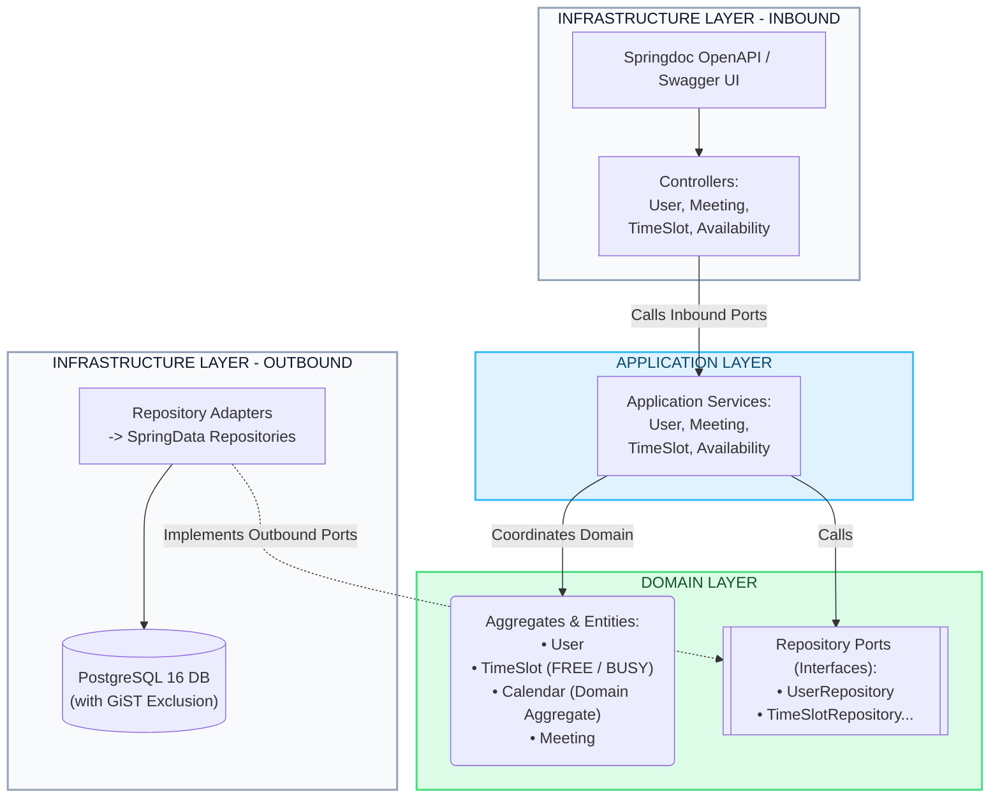
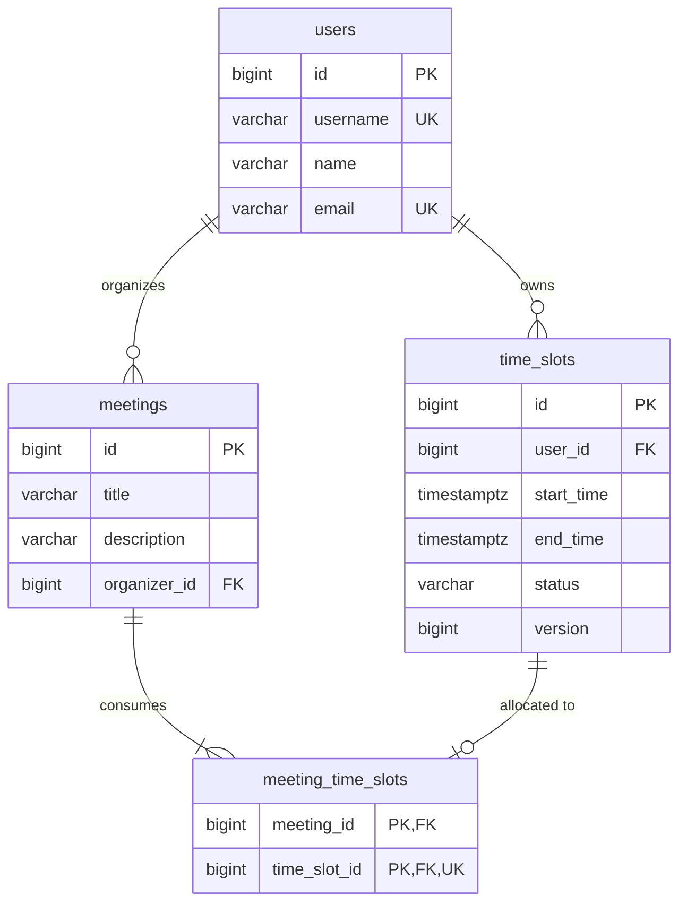

# Mini Doodle - Meeting Scheduling Platform

## Table of Contents
- [Project Overview](#project-overview)
- [Key Features](#key-features)
- [Technology Stack](#technology-stack)
- [Architecture](#architecture)
- [Architectural & Design Decisions](#architectural--design-decisions)
- [Database Design](#database-design)
- [Tech Stack & Performance Strategy](#tech-stack--performance-strategy)
- [Future Scalability & Caching Strategy](#future-scalability--caching-strategy)
- [Metrics & Observability](#metrics--observability)
- [API Endpoints](#api-endpoints)
- [Swagger API Documentation](#swagger-api-documentation)
- [Recommended API Testing Flow](#recommended-api-testing-flow)
- [Example API Payloads](#example-api-payloads)
- [Run Locally Without Docker](#run-locally-without-docker)
- [Run With Docker Compose](#run-with-docker-compose)
- [Testing](#testing)
- [Project Structure](#project-structure)
- [Future Improvements](#future-improvements)

---

<a id="project-overview"></a>
## Overview

This project is a high-performance simulation of a meeting scheduling platform designed using Java and Spring Boot. It
enables users to proactively manage their time slots, schedule meetings, and view custom calendar availability. All data
is permanently persisted to allow for proper management and querying.

---

<a id="key-features"></a>
## Key Features

- **Proactive Availability Model:** Users manage discrete, non-overlapping `FREE` time slots, explicitly declaring when they are open to collaborate.
- **Atomic Multi-Participant Meeting Scheduling:** Meetings require pre-existing matching `FREE` slots for both the organizer and all invited participants; slots are atomically converted to `BUSY`.
- **Automatic Slot Release upon Cancellation:** Cancelling a scheduled meeting automatically transitions all consumed participant and organizer time slots back to `FREE`.
- **Multi-User Availability Aggregation:** High-performance queries calculate calendar availability across hundreds of users simultaneously with optional `freeOnly` filtering.
- **Zero Double-Booking Guarantee:** Enforced at two layers: Optimistic Locking (`@Version`) in the JPA domain and PostgreSQL GiST exclusion constraints (`btree_gist`) at the physical database layer.
- **Hexagonal Architecture (Ports & Adapters):** Strict decoupling between domain business rules, application orchestration, and infrastructure adapters (Web MVC, JPA, Actuator).

---

<a id="technology-stack"></a>
## Technology Stack

| Layer / Concern | Technology | Version | Rationale |
|---|---|---|---|
| **Runtime & Language** | Java (OpenJDK) | 25 | Latest modern Java runtime with modern language features and virtual thread support |
| **Framework** | Spring Boot | 3.5.16 | Core enterprise ecosystem (Web MVC, Data JPA, Validation, Actuator) |
| **Relational Database** | PostgreSQL | 16-alpine | Advanced ACID persistence with GiST indexing and exclusion constraint support |
| **Schema Migrations** | Liquibase + PreLiquibase | 4.x / 1.6.1 | Deterministic, version-controlled database evolution and extension initialization |
| **API Documentation** | Springdoc OpenAPI (Swagger UI) | 2.8.17 | Interactive OpenAPI 3 specification explorer and runtime schema generation |
| **Mapping & Boilerplate** | MapStruct & Lombok | 1.6.3 / 1.18.48 | Zero-overhead compile-time bean mapping and boilerplate generation |
| **Metrics & Telemetry** | Micrometer & Prometheus | Starters | Native metrics instrumentation for JVM, HikariCP, and custom business operations |
| **Containerization** | Docker & Docker Compose | Latest | Full containerized local environment for database and application |
| **Integration Testing** | Testcontainers | 1.20.4 | Ephemeral, isolated PostgreSQL database containers for reliable test suites |
| **HTTP Client Testing** | IntelliJ HTTP Client | Native | Preconfigured runnable `.http` test scripts in `httpclient/` |

---

<a id="architecture"></a>
## Architecture

The system adheres to **Hexagonal Architecture (Ports & Adapters)** and **Domain-Driven Design (DDD)** principles:



- **Domain Layer (`domain.*`):** Pure Java domain models, business exceptions, and repository interface ports. Free from Spring, JPA, or database framework dependencies.
- **Application Layer (`application.*`):** Orchestrates use cases, enforces transactional boundaries (`@Transactional`), and coordinates domain aggregates and metrics.
- **Infrastructure Layer (`infrastructure.*`):** Adapters for REST HTTP controllers, MapStruct DTO mappers, JPA entities, Spring Data repositories, Liquibase migrations, and Actuator metrics configurations.

---

<a id="architectural--design-decisions"></a>
## Architectural & Design Decisions

### 1. The "Calendar" Concept (Domain-Driven Design)

Following the specification, the term "Calendar" is treated strictly as a domain concept. There is no monolithic
`Calendar` entity or table in the database. Instead, a Calendar is logically represented by an aggregate of
non-overlapping `TimeSlot`s belonging to a specific user.

### 2. Simplified Data Model

To efficiently support hundreds of users with thousands of slots, the relational model is kept normalized and
straightforward:

* **User**: Represents a registered platform user.
* **TimeSlot**: Represents a block of time proactively created by a user. It contains `start_time` (timestamp),
  `end_time` (timestamp), and a `status` (FREE or BUSY). Users can create, modify, and delete their own time slots.
  Database-level constraints (e.g., exclusion constraints) guarantee that a single user's slots never overlap.
* **Meeting**: Created when converting an available slot into a booked event. It stores meeting details such as the
  title and description, and links to the specific `TimeSlot`s that were consumed.

### 3. Proactive Availability & Participant Handling

The platform relies on proactive availability: users must explicitly create available time slots to be bookable.

* Participants added to a meeting are assumed to be existing platform users.
* To successfully invite a participant, they must have a pre-existing `FREE` slot matching the meeting's timeframe. If a
  slot does not exist, the system assumes the user is unavailable.
* Booking a meeting does not create new overlapping slots; it simply updates the `status` of all involved participants'
  existing `TimeSlot`s from `FREE` to `BUSY`.
* While time slots can have configurable durations and be modified, meetings themselves do not have an independent
  modifiable duration; they inherit the timeframe of the slots they consume.
* **Why TimeSlot IDs are not used in the Schedule Meeting API**: The meeting creation request (`ScheduleMeetingRequest`)
  does **not** accept physical TimeSlot identifiers (`timeSlotId`). Instead, it accepts the desired `startTime`,
  `endTime`, `organizerId`, and `participantIds`. The domain service dynamically resolves, verifies, and locks the
  matching `FREE` time slots for all involved parties ($N$ distinct time slots for $N$ participants). Requiring the
  client to know and supply individual TimeSlot IDs for each participant would leak internal storage identifiers into the
  scheduling abstraction and introduce client-side coordination overhead. It would also create race conditions if
  individual slots are modified or re-created before the booking request is dispatched.

### 4. Concurrency Control (Preventing Double-Booking)

Given the requirement for a high-performance simulation, converting a `FREE` slot to a `BUSY` meeting is protected
against race conditions.

* **Optimistic Locking** (using a `@Version` field in JPA) is implemented on the `TimeSlot` entity. If two users attempt
  to book the exact same free slot simultaneously, the database will reject the second transaction, preventing
  double-booking without the performance penalty of pessimistic database locks.

---

<a id="database-design"></a>
## Database Design

The relational schema is maintained via Liquibase changelogs (`src/main/resources/db/changelog/`):



### PostgreSQL-Specific Features & Integrity Constraints
1. **Exclusion Constraint on Time Slots:**
   Uses PostgreSQL's `btree_gist` extension to enforce at the DB engine level that time slots belonging to the same user never overlap:
   ```sql
   ALTER TABLE time_slots
       ADD CONSTRAINT ex_time_slots_no_overlap
       EXCLUDE USING gist (user_id WITH =, tstzrange(start_time, end_time) WITH &&);
   ```
2. **One Meeting per Time Slot:**
   `meeting_time_slots` includes a unique constraint on `time_slot_id` (`CONSTRAINT uk_meeting_time_slots_slot UNIQUE (time_slot_id)`), ensuring that a physical slot can only ever be assigned to one meeting.
3. **Sequence Allocation Optimization:**
   The `time_slots_id_seq` sequence uses an increment/allocation size of 50 to optimize bulk inserts during high simulation loads.

---

<a id="tech-stack--performance-strategy"></a>
## Tech Stack & Performance Strategy

### Spring MVC & Database Optimization

To meet the requirement of handling hundreds of users and thousands of slots, the system utilizes standard Spring MVC
and a well-indexed relational database (PostgreSQL).

* **Avoiding Over-engineering**: For this specific volume of data and concurrent users, introducing reactive programming
  (WebFlux) or complex distributed queues is unnecessary. Standard servlet-based MVC handles hundreds of concurrent
  connections natively.
* **Query Optimization**: The requirement to provide an aggregated view for a selected time frame is solved via highly
  optimized SQL/JPQL queries using B-Tree indexes on `start_time`, `end_time`, and `status`. This avoids iterating
  through thousands of records in memory and prevents the JPA N+1 problem.

---

<a id="future-scalability--caching-strategy"></a>
## Future Scalability & Caching Strategy

The current system is designed to efficiently handle the required load (hundreds of users, thousands of slots) using
optimized database indexes, as database buffer caches are more than sufficient for this volume.

However, if the platform were to scale to **millions of users** or become highly read-heavy (e.g., users constantly
refreshing the aggregated availability view), the following horizontal scaling strategies would be introduced:

* **Distributed Caching (Redis):** To cache the aggregated views of frequent timeframes.
* **Cache Invalidation:** Implementing an event-driven cache eviction policy. When a `TimeSlot` is updated or a
  `Meeting` is booked, an event would clear the specific aggregated timeframe cache entries to prevent stale
  availability data.
* **Local Caching (Caffeine):** A first-level L1 cache in the application instances for nearly-static data, though less
  applicable for highly mutable scheduling data.

---

<a id="metrics--observability"></a>
## Metrics & Observability

To fulfill the requirement for metrics and ensure the high-performance simulation can be monitored, the service
integrates **Spring Boot Actuator** with **Micrometer (Prometheus registry)**.

### Available Metrics

* **Technical Metrics:** JVM memory, CPU usage, HTTP request latency, and HikariCP database connection pool metrics.
  Monitoring the DB connection pool is crucial for the concurrent load of hundreds of simulated users.
* **Business Metrics (Custom):**
    * `meetings.scheduled.total` (Counter): Tracks the number of successfully booked meetings.
    * `slots.aggregated.view.time` (Timer): Monitors the execution time of the complex availability queries to ensure
      the aggregated view remains performant.

---

<a id="api-endpoints"></a>
## API Endpoints

All endpoints are versioned under `/api/v1` and produce/consume `application/json` (or `application/problem+json` for RFC 7807 error details).

### 1. Users
| Method | Endpoint | Description | Status Codes |
|---|---|---|---|
| `POST` | `/api/v1/users` | Register a new user profile | `201 Created`, `400 Bad Request`, `409 Conflict` |

### 2. Time Slots
| Method | Endpoint | Description | Status Codes |
|---|---|---|---|
| `POST` | `/api/v1/time-slots` | Proactively create a new `FREE` time slot | `201 Created`, `400 Bad Request`, `409 Conflict` |
| `PUT` | `/api/v1/time-slots/{id}` | Update start/end times of a `FREE` slot | `200 OK`, `400 Bad Request`, `404 Not Found`, `409 Conflict` |
| `DELETE` | `/api/v1/time-slots/{id}` | Delete an existing `FREE` time slot | `204 No Content`, `400 Bad Request`, `404 Not Found`, `409 Conflict` |

### 3. Meetings
| Method | Endpoint | Description | Status Codes |
|---|---|---|---|
| `POST` | `/api/v1/meetings` | Schedule a meeting (consumes matching slots to `BUSY`) | `201 Created`, `400 Bad Request`, `404 Not Found`, `409 Conflict` |
| `GET` | `/api/v1/meetings/{id}` | Retrieve details of a scheduled meeting | `200 OK`, `404 Not Found` |
| `GET` | `/api/v1/meetings` | Query meetings by `organizerId` and/or `participantId` | `200 OK`, `400 Bad Request` |
| `DELETE` | `/api/v1/meetings/{id}` | Cancel meeting and release consumed slots back to `FREE` | `204 No Content`, `400 Bad Request`, `404 Not Found` |

### 4. Availability & Calendars
| Method | Endpoint | Description | Status Codes |
|---|---|---|---|
| `GET` | `/api/v1/availability/users/{userId}` | Retrieve personal calendar view (optional timeframe filter) | `200 OK`, `400 Bad Request`, `404 Not Found` |
| `GET` | `/api/v1/availability/aggregate` | Aggregated availability across all or selected users | `200 OK`, `400 Bad Request` |

### 5. Actuator & Observability
| Method | Endpoint | Description | Status Codes |
|---|---|---|---|
| `GET` | `/actuator/health` | Service liveness and readiness health checks | `200 OK` |
| `GET` | `/actuator/prometheus` | Prometheus-formatted metrics scrape endpoint | `200 OK` |
| `GET` | `/actuator/metrics` | List all tracked technical and business metric names | `200 OK` |

---

<a id="swagger-api-documentation"></a>
## Swagger API Documentation

When the application is running (locally or via Docker Compose), the interactive OpenAPI / Swagger UI documentation is available to inspect, explore, and execute requests against all endpoints:

* **Interactive Swagger UI:** [http://localhost:8080/swagger-ui.html](http://localhost:8080/swagger-ui.html)
* **OpenAPI 3 JSON Specification:** [http://localhost:8080/v3/api-docs](http://localhost:8080/v3/api-docs)
* **OpenAPI 3 YAML Specification:** [http://localhost:8080/v3/api-docs.yaml](http://localhost:8080/v3/api-docs.yaml)

### Preconfigured IntelliJ HTTP Client Scripts
For quick API exploration directly inside IntelliJ IDEA or VS Code (via REST Client extensions), ready-to-run `.http` files are provided in the [`httpclient/`](file:///Users/hernando/repos/applications/minidoodle/httpclient) directory:
- [`httpclient/users.http`](file:///Users/hernando/repos/applications/minidoodle/httpclient/users.http): Register Alice, Bob, and Charlie.
- [`httpclient/time-slots.http`](file:///Users/hernando/repos/applications/minidoodle/httpclient/time-slots.http): Create, update, and delete availability slots.
- [`httpclient/meetings.http`](file:///Users/hernando/repos/applications/minidoodle/httpclient/meetings.http): Schedule meetings, filter by participants, and cancel meetings.
- [`httpclient/availability.http`](file:///Users/hernando/repos/applications/minidoodle/httpclient/availability.http): Query personal calendars and aggregated views.
- [`httpclient/actuator.http`](file:///Users/hernando/repos/applications/minidoodle/httpclient/actuator.http): Inspect Prometheus metrics and connection pools.

---

<a id="recommended-api-testing-flow"></a>
## Recommended API Testing Flow

To test the complete lifecycle of proactive availability and meeting management:

1. **Register Users:**
   Create an organizer (`alice`) and a participant (`bob`) via `POST /api/v1/users`.
2. **Declare Proactive Availability:**
   - Create a `FREE` slot for `alice` (e.g., `2026-11-20T10:00:00Z` to `2026-11-20T11:00:00Z`) via `POST /api/v1/time-slots`.
   - Create a matching `FREE` slot for `bob` for the identical timeframe via `POST /api/v1/time-slots`.
3. **Query Availability:**
   - Retrieve Alice's personal calendar via `GET /api/v1/availability/users/{aliceId}` to verify the `FREE` slot.
   - Query aggregated availability via `GET /api/v1/availability/aggregate?startTime=2026-11-20T00:00:00Z&endTime=2026-11-20T23:59:59Z&freeOnly=true` to verify both users appear available.
4. **Schedule the Meeting:**
   - Schedule the meeting via `POST /api/v1/meetings` with `organizerId: aliceId`, `participantIds: [bobId]`, and the matching timeframe.
   - The response returns status `201 Created` and shows 2 consumed slots.
5. **Verify Slots Transitioned to BUSY:**
   - Re-query aggregated availability with `freeOnly=true`; neither Alice nor Bob will appear in this window.
   - Query without `freeOnly=true`; both slots now show `status: "BUSY"`.
6. **Cancel the Meeting:**
   - Call `DELETE /api/v1/meetings/{meetingId}` (returns `204 No Content`).
   - Query availability again; the slots for Alice and Bob are automatically released back to `FREE`.

---

<a id="example-api-payloads"></a>
## Example API Payloads

### 1. Register a User
**Request:** `POST /api/v1/users`
```json
{
  "username": "alice",
  "name": "Alice Wonderland",
  "email": "alice@example.com"
}
```
**Response:** `201 Created`
```json
{
  "id": 1,
  "username": "alice",
  "name": "Alice Wonderland",
  "email": "alice@example.com"
}
```

### 2. Create a Time Slot
**Request:** `POST /api/v1/time-slots`
```json
{
  "userId": 1,
  "startTime": "2026-11-20T10:00:00Z",
  "endTime": "2026-11-20T11:00:00Z"
}
```
**Response:** `201 Created`
```json
{
  "id": 10,
  "user": {
    "id": 1,
    "username": "alice",
    "name": "Alice Wonderland"
  },
  "startTime": "2026-11-20T10:00:00Z",
  "endTime": "2026-11-20T11:00:00Z",
  "status": "FREE"
}
```

### 3. Schedule a Meeting
**Request:** `POST /api/v1/meetings`
```json
{
  "title": "Sprint Planning",
  "description": "Bi-weekly sprint planning session",
  "organizerId": 1,
  "participantIds": [2],
  "startTime": "2026-11-20T10:00:00Z",
  "endTime": "2026-11-20T11:00:00Z"
}
```
**Response:** `201 Created`
```json
{
  "id": 100,
  "title": "Sprint Planning",
  "description": "Bi-weekly sprint planning session",
  "organizer": {
    "id": 1,
    "username": "alice",
    "name": "Alice Wonderland"
  },
  "participants": [
    {
      "id": 2,
      "username": "bob",
      "name": "Bob Builder"
    }
  ],
  "timeSlots": [
    {
      "id": 10,
      "user": { "id": 1, "username": "alice", "name": "Alice Wonderland" },
      "startTime": "2026-11-20T10:00:00Z",
      "endTime": "2026-11-20T11:00:00Z",
      "status": "BUSY"
    },
    {
      "id": 11,
      "user": { "id": 2, "username": "bob", "name": "Bob Builder" },
      "startTime": "2026-11-20T10:00:00Z",
      "endTime": "2026-11-20T11:00:00Z",
      "status": "BUSY"
    }
  ]
}
```

### 4. Query Aggregated Availability
**Request:** `GET /api/v1/availability/aggregate?startTime=2026-11-20T00:00:00Z&endTime=2026-11-20T23:59:59Z&freeOnly=true`

**Response:** `200 OK`
```json
[
  {
    "id": 12,
    "user": {
      "id": 3,
      "username": "charlie",
      "name": "Charlie Brown"
    },
    "startTime": "2026-11-20T14:00:00Z",
    "endTime": "2026-11-20T15:00:00Z",
    "status": "FREE"
  }
]
```

---

<a id="run-locally-without-docker"></a>
## Run Locally Without Docker

### Prerequisites
- **JDK 25** installed (`java -version`).
- A running PostgreSQL 16 instance with credentials matching `application.yml`:
  ```bash
  export SPRING_DATASOURCE_URL="jdbc:postgresql://localhost:5432/minidoodle"
  export SPRING_DATASOURCE_USERNAME="postgres"
  export SPRING_DATASOURCE_PASSWORD="postgres"
  ```

### Build and Launch
```bash
# Build the project
./gradlew build -x test

# Run the Spring Boot application
./gradlew bootRun
```
The application will start on port `8080`.

---

<a id="run-with-docker-compose"></a>
## Getting Started

### Prerequisites

* Docker and Docker Compose installed on your machine.

### Running the Application

The solution is fully containerized and runnable locally using `docker-compose`. All necessary dependencies, including
the database, are bundled in the compose file. Database schemas and initial structures are automatically managed on
startup via database migration tools (Liquibase).

To start the service, run:

```bash
docker-compose up -d
```

To stop the containers:
```bash
docker-compose down
```

---

<a id="testing"></a>
## Testing

The project maintains comprehensive test coverage at multiple testing layers:

### Unit & Integration Tests
Runs domain unit tests and Spring Data JPA integration tests against an ephemeral PostgreSQL container using Testcontainers:
```bash
./gradlew test
```

---

<a id="project-structure"></a>
## Project Structure

```
minidoodle/
├── build.gradle.kts                # Root project build configuration
├── settings.gradle.kts             # Gradle settings
├── docker-compose.yml              # Multi-container orchestration (App + PostgreSQL)
├── Dockerfile                      # Multi-stage production container build
├── httpclient/                     # Preconfigured IntelliJ HTTP Client exploration scripts
│   ├── users.http
│   ├── time-slots.http
│   ├── meetings.http
│   ├── availability.http
│   └── actuator.http
├── src/
│   ├── main/
│   │   ├── java/de/com/saenz/minidoodle/
│   │   │   ├── MinidoodleApplication.java
│   │   │   ├── domain/             # Pure Domain Model & Repository Ports
│   │   │   │   ├── model/          # User, TimeSlot, Calendar aggregate, Meeting
│   │   │   │   ├── repository/     # Domain repository interfaces
│   │   │   │   ├── usecase/        # Use case commands, queries, and ports
│   │   │   │   └── exception/      # Domain business exceptions
│   │   │   ├── application/        # Application services & transactional orchestration
│   │   │   │   └── service/        # MeetingApplicationService, TimeSlotApplicationService, ...
│   │   │   └── infrastructure/     # External adapters & framework configs
│   │   │       ├── api/            # Spring MVC REST Controllers & DTOs
│   │   │       ├── persistence/    # JPA entities, Spring Data Repositories, Adapters
│   │   │       └── config/         # OpenAPI, Jackson, Actuator configs
│   │   └── resources/
│   │       ├── application.yml     # Application configuration & metrics definitions
│   │       └── db/changelog/       # Liquibase migrations & PostgreSQL constraints
│   └── test/                       # Unit & Slice Integration tests with Testcontainers
```

---

<a id="future-improvements"></a>
## Future Improvements

- **Recurring Time Slots:** Support recurring rules (e.g., RRULE / weekly repeating availability) expanded dynamically into discrete slot ranges.
- **Event-Driven Cache Eviction:** Implement Redis caching for aggregated queries combined with Spring application events (`@TransactionalEventListener`) or Kafka for cache invalidation.
- **Notification Subsystem:** Asynchronous email/webhook delivery upon meeting confirmation, reschedule, or cancellation.
- **Dynamic Time Zone Conversions:** Accept user-preferred IANA time zones (e.g., `Europe/Berlin`, `America/New_York`) displaying localized intervals while storing in UTC.